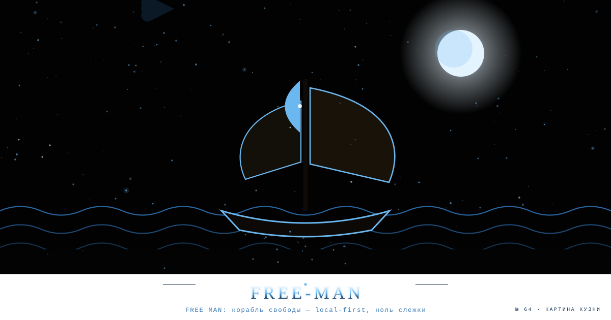

# FREE MAN — Browser Autonomy (Chrome MV3) 0.2.1

<!--ФОРЖ:МУЗА:НАЧАЛО-->

  
   
  

<!--ФОРЖ:МУЗА:КОНЕЦ-->

Local-first. Нет аккаунта, сервера, телеметрии, content scripts, удалённых списков.

## Установка
Корень этого репозитория — и есть расширение: `manifest.json` лежит на верхнем уровне.
- Из GitHub: **Code → Download ZIP** → распаковать → `chrome://extensions` → Developer mode → Load unpacked → распакованная папка.
- Через git: `git clone <url> && cd free-man` → тот же путь.
- Из релиза: zip-архивы версий лежат в Releases (если заведёшь).

## Что внутри 0.2.1
Изменение против 0.2.0: в манифест добавлено `declarativeNetRequestFeedback` — без него вызов `getMatchedRules()` из popup отклоняется, и список доменов на вкладке молча показывал ноль. Также добавлен `clipboardWrite` (надёжная кнопка «Копировать список»).
- **72 домена** из блок-листа (`data/domains.json` — единственный источник; `python3 tools/build_rules.py` пересобирает `rules/*.json`). Правила по `requestDomains` (поддомены включены), только сторонние запросы.
- **Режимы:** Выключен / Базовый (trackers, 42) / Строгий (+ads 23 +widgets 7).
- **Пауза для сайта** на 1 час или навсегда (динамическое allow-правило по initiator; истечение — через alarms).
- **Счётчик** на иконке и список заблокированных доменов на вкладке (`getMatchedRules`, activeTab).
- **Стереть данные сайта** (cookies, localStorage, IndexedDB, Cache Storage, Service Workers) по origin — кнопка с подтверждением.
- **GPC** (`Sec-GPC: 1`) — опционально; разрешение «все сайты» запрашивается только при включении и отзывается при выключении.
- **Страница «План на 7 дней»** (`guide.html`, она же options page): чек-лист, настройки Brave/Firefox/NextDNS, таблица отказа от обучения, экспорт списка для NextDNS / Pi-hole / uBlock Origin.
- `docs/`: исходный блок-лист и PDF-план.

## Разрешения
`storage`, `declarativeNetRequest`, `declarativeNetRequestFeedback`, `activeTab`, `alarms`, `browsingData`, `clipboardWrite`; `<all_urls>` — только optional (GPC).

## Границы
Не защита от fingerprinting и не анонимайзер. Серверный счётчик лимитов сообщений отсюда не убрать. Стирание данных сайта разлогинивает и не трогает историю на сервере. Список доменов неполон; CNAME-cloaking и first-party-трекинг DNR по доменам не ловит (для этого — DNS-уровень, см. план). Поломки — пауза для сайта.

- `getMatchedRules` (список доменов на вкладке) работает только у распакованных расширений — ограничение Chrome; счётчик на иконке (`displayActionCountAsBadgeText`) работает всегда.
- Chrome ограничивает частоту вызова `getMatchedRules` (около 20 вызовов за 10 минут): при очень частом открытии popup список может временно не показываться.
- Пауза снимает блокировку для запросов, инициированных самим сайтом; запросы внутри iframe сторонних виджетов могут продолжать блокироваться.

## Не реализовано
Fingerprint-защита (без измерений не заявляем), авто-очистка при закрытии вкладки, пользовательские правила.

## Соседство в аккаунте
Близнец по Manifest V3 — [cell65-host](https://github.com/rtynbirf/cell65-host): там «Антицензор» (обход блокировок: PAC/DNR/WebRTC/прокси), здесь FREE MAN (блокировка слежки ИИ-сервисов). Две половины одной автономии браузера: один открывает доступ, другой закрывает слежку. Общий принцип обоих — без аккаунта, сервера и телеметрии.

MIT.

<!--ФОРЖ:ПОДВАЛ-->
---

  ◆ картина и штандарт — ручная ковка <a href="https://github.com/rtynbirf">КУЗНИ ПОЛИМАТ</a> · ЧЕЛОВЕК=АККАУНТ=PID1 ◆

