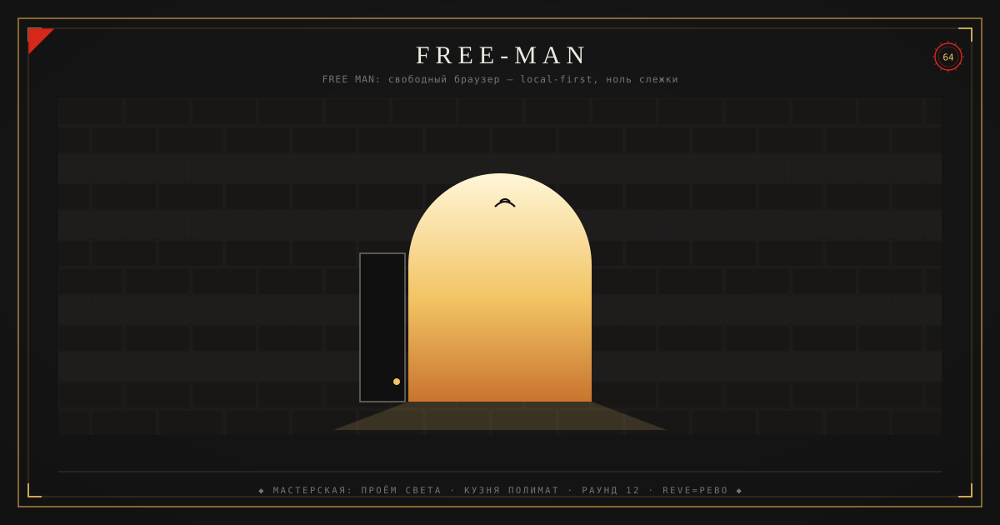
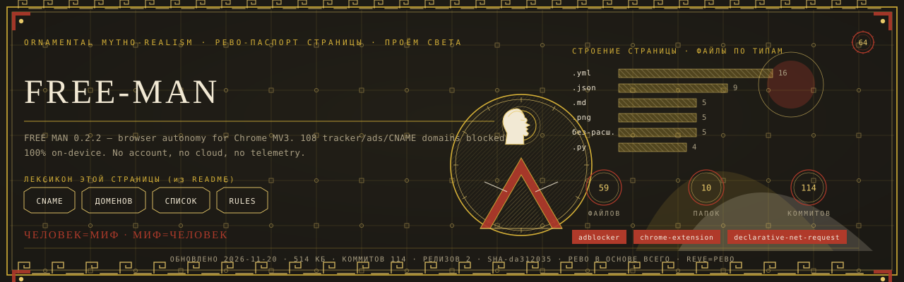
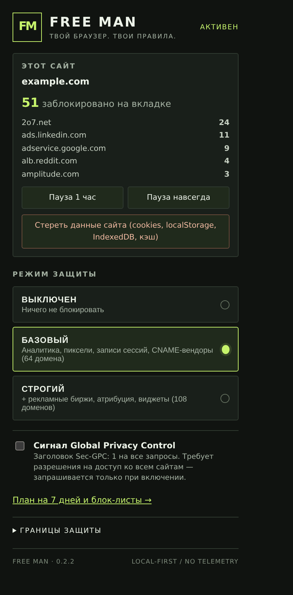
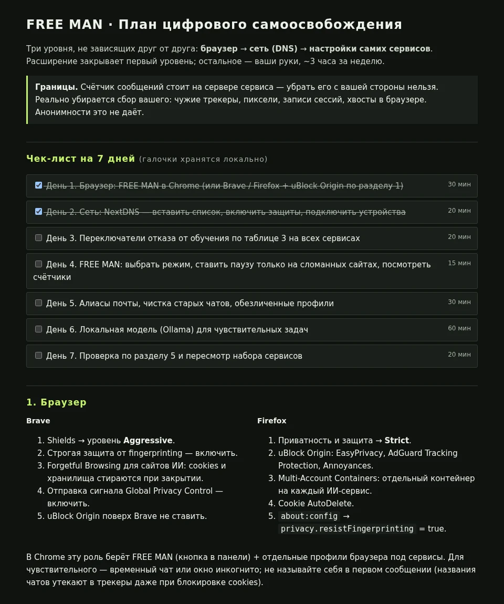

  

<!--ФОРЖ:МУЗА:НАЧАЛО-->

  
   
  

<!--ФОРЖ:МУЗА:КОНЕЦ-->

<!--ФОРЖ:ПАСПОРТ:НАЧАЛО-->

  

| ФАЙЛОВ | ПАПОК | КОММИТОВ | ОБНОВЛЕНО | РЕЛИЗОВ |
|---:|---:|---:|---|---:|
| 43 | 8 | 23 | 2026-11-15 | 2 |
<!--ФОРЖ:ПАСПОРТ:КОНЕЦ-->

# FREE MAN — Browser Autonomy (Chrome MV3) 0.2.2

**Local-first блокировка трекеров для Chrome. Нет аккаунта, сервера, телеметрии, content scripts, удалённых списков.**

[Русский](README.md) | [English](README.en.md)

## Возможности

| | |
|---|---|
| Домены в блок-листе | **108** (trackers 48 / ads 30 / widgets 14 / cname 16) |
| Режимы | Выключен / **Базовый** (trackers + cname, 64) / **Строгий** (+ads, +widgets — 108) |
| CNAME-клоакинг | тир cname из публичного списка AdGuard `cname-trackers` — отдельный ruleset в Базовом режиме |
| Пауза для сайта | 1 час или навсегда; динамическое allow-правило с истечением через alarms |
| Счётчик | живой бейдж на иконке + список заблокированных доменов вкладки (`getMatchedRules`) |
| Стирание данных сайта | cookies, localStorage, IndexedDB, Cache Storage, Service Workers — по origin |
| GPC | `Sec-GPC: 1`, опционально; `<all_urls>` запрашивается только при включении, отзывается при выключении |
| План на 7 дней | встроенный гид (`guide.html`): хардненинг Brave/Firefox, экспорт в NextDNS / Pi-hole / uBlock Origin |

## Установка

Корень этого репозитория — и есть расширение: `manifest.json` лежит на верхнем уровне.

- Из релиза: [Releases](https://github.com/rtynbirf/free-man/releases) — zip версии + PDF-план отдельным ассетом.
- Из GitHub: **Code → Download ZIP** → распаковать.
- Через git: `git clone https://github.com/rtynbirf/free-man.git`

Дальше: `chrome://extensions` → включить **Developer mode** → **Load unpacked** → выбрать распакованную папку.

## Скриншоты

## Почему local-first

- Блок-лист собирается из единственного источника `data/domains.json` и компилируется в статические `rules/*.json` скриптом `tools/build_rules.py` — воспроизводимо, проверяемо, под CI-замком: гейт `rules-lint` пересобирает и сверяет диффом на каждое изменение.
- Тир cname — из публичного списка AdGuard `cname-trackers`: канонические цели CNAME-клоакинга, в отдельном ruleset.
- Те же 108 доменов выгружаются из guide как блок-листы NextDNS / Pi-hole / uBlock Origin — DNS-уровень и другие браузеры под тем же списком.
- Некуда стучаться: счётчики считаются на машине, списки лежат внутри расширения, бэкенда не существует — по конструкции, а не по обещанию.

## Что внутри 0.2.2

Изменение против 0.2.1: блок-лист 72 → 108 доменов и новый тир **cname** — канонические цели CNAME-клоакинга (источник — публичный список AdGuard `cname-trackers`), вынесен в отдельный ruleset и включён в Базовый режим. Полная история — в [CHANGELOG.md](CHANGELOG.md). Что было в 0.2.1: `declarativeNetRequestFeedback` — без него вызов `getMatchedRules()` из popup отклоняется и список доменов на вкладке молча показывает ноль; `clipboardWrite` для кнопки «Копировать список».

- **108 доменов** из блок-листа (`data/domains.json` — единственный источник; `python3 tools/build_rules.py` пересобирает `rules/*.json`). Правила по `requestDomains` (поддомены включены), только сторонние запросы. Тиры: trackers 48 / ads 30 / widgets 14 / cname 16.
- **CNAME-клоакинг:** в браузере блокируются прямые обращения к вендорам, маскирующимся через CNAME; замаскированные хосты (`client.site.com` → `vendor.net`) закрывает DNS-уровень — все 108 доменов выгружаются через экспорт NextDNS / Pi-hole / uBlock Origin в guide.
- **Пауза для сайта** на 1 час или навсегда (динамическое allow-правило по initiator; истечение — через alarms).
- **Счётчик** на иконке и список заблокированных доменов на вкладке (`getMatchedRules`, activeTab).
- **Стереть данные сайта** (cookies, localStorage, IndexedDB, Cache Storage, Service Workers) по origin — кнопка с подтверждением.
- **GPC** (`Sec-GPC: 1`) — опционально; разрешение «все сайты» запрашивается только при включении и отзывается при выключении.
- **Страница «План на 7 дней»** (`guide.html`, она же options page): чек-лист, настройки Brave/Firefox/NextDNS, таблица отказа от обучения, экспорт списка для NextDNS / Pi-hole / uBlock Origin.
- `docs/`: исходный блок-лист (`blocklist_domains.txt`) и указатель на PDF-план; сам PDF живёт в релизе как ассет — бинарники >100 КБ в git не ходят.

## Разрешения

`storage`, `declarativeNetRequest`, `declarativeNetRequestFeedback`, `activeTab`, `alarms`, `browsingData`, `clipboardWrite`; `<all_urls>` — только optional (GPC).

## Границы

Не защита от fingerprinting и не анонимайзер. Серверный счётчик лимитов сообщений отсюда не убрать. Стирание данных сайта разлогинивает и не трогает историю на сервере. Список доменов неполон; замаскированные CNAME-хосты DNR по доменам не распутывает — в браузере блокируются прямые обращения к вендорам, распутывание цепочек остаётся за DNS-уровнем (экспорт из guide, см. план). Поломки — пауза для сайта.

- `getMatchedRules` (список доменов на вкладке) работает только у распакованных расширений — ограничение Chrome; счётчик на иконке (`displayActionCountAsBadgeText`) работает всегда.
- Chrome ограничивает частоту вызова `getMatchedRules` (около 20 вызовов за 10 минут): при очень частом открытии popup список может временно не показываться.
- Пауза снимает блокировку для запросов, инициированных самим сайтом; запросы внутри iframe сторонних виджетов могут продолжать блокироваться.

## Не реализовано

Fingerprint-защита (без измерений не заявляем), авто-очистка при закрытии вкладки, пользовательские правила.

## Проект

- [CHANGELOG.md](CHANGELOG.md) — полная история версий
- [SECURITY.md](SECURITY.md) — приватный репорт уязвимостей через Security Advisories
- [README.en.md](README.en.md) — витрина на английском
- [Releases](https://github.com/rtynbirf/free-man/releases) — zip расширения + PDF-план «7 дней цифрового самоосвобождения»

MIT — [LICENSE](LICENSE).

<!--ФОРЖ:ПОДВАЛ-->
---

  ◆ картина и штандарт — ручная ковка <a href="https://github.com/rtynbirf">КУЗНИ ПОЛИМАТ</a> · ЧЕЛОВЕК=АККАУНТ=PID1 ◆

